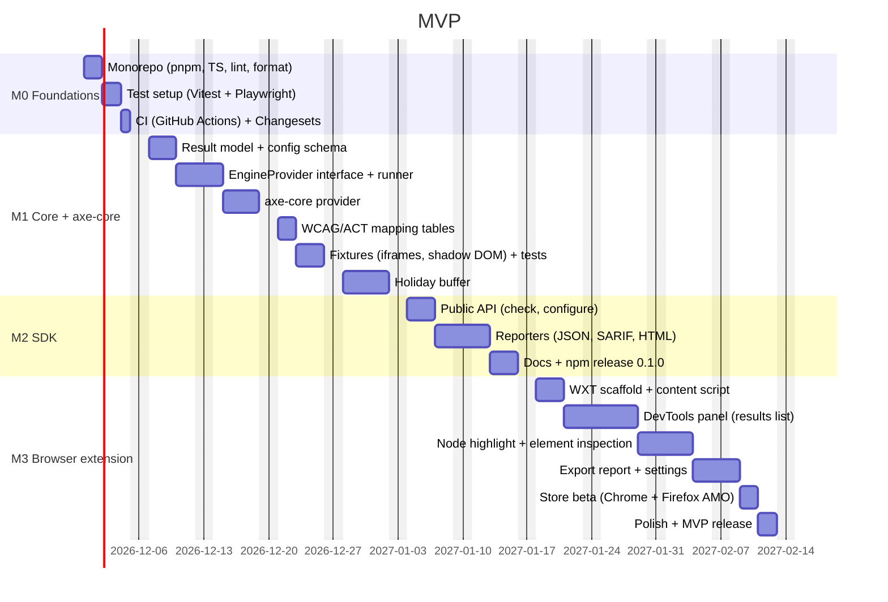

# MVP plan (2026-11-26)

The MVP consists of the core engine wrapping axe-core, an SDK published to npm and a
browser extension for Chrome and Firefox. See [overview.md](overview.md) for the strategy.

## M0 — Foundations

- pnpm workspaces monorepo, TypeScript (strict), ESLint + Prettier.
- Vitest for unit tests (happy-dom). Playwright for tests that need a real browser
  (layout, contrast).
- GitHub Actions: lint, typecheck, test, build. Changesets for versioning.

**Done when:** an empty package builds and is tested in CI.

## M1 — Core engine + axe-core provider

- **Result model:** `Issue { id, ruleId, engine, impact, outcome (violation | incomplete |
  pass), wcag[], actRuleIds[], help, helpUrl, nodes[{ selector, xpath?, html, frame? }] }`.
- **Config:** WCAG version and level (2.1/2.2, A/AA/AAA), rule include/exclude lists,
  scope (`include`/`exclude` selectors), and the list of enabled engines.
- **`EngineProvider` interface:** `{ id, version, run(context, config): Promise<RawResult>,
  normalize(raw): Issue[] }`. The runner executes the providers and merges their output.
- **axe-core provider:** maps our config to axe tags and rules, and maps axe results to `Issue`.
- **Mapping tables:** WCAG success criteria and ACT rule IDs for each axe rule.
- **Fixtures:** basic pages, iframes, shadow DOM, dynamic content.

**Done when:** `run(document, config)` returns normalized issues for the fixtures, and
these tests pass both in happy-dom and in Chromium.

## M2 — SDK

- Public API: `check(target?, options?)`, `createChecker(config)`, typed results.
- Builds: ESM + CJS for Node/bundlers, plus a self-contained IIFE bundle that can be
  injected into pages (used by the extension and by future E2E adapters).
- Reporters: JSON, **SARIF 2.1** (GitHub code scanning) and a standalone HTML report.
- Docs: README, API reference, examples.

**Done when:** `@a11y-checker/sdk@0.1.0` is published to npm.

## M3 — Browser extension (Chrome + Firefox)

- WXT + Manifest V3, with Chrome and Firefox builds from the same code.
- The content script injects the IIFE bundle, with `all_frames` enabled.
- DevTools panel lists results grouped by rule, impact or WCAG criterion.
- Clicking an issue highlights the node and lets the user inspect it in the Elements panel.
- Settings (WCAG level, engines), plus export to JSON, SARIF and HTML.
- Minimal permissions (`activeTab`, `scripting`). Early beta listings on the Chrome Web Store
  and on Firefox Add-ons (AMO).

**Done when:** the extension is published as an unlisted beta on both stores and can audit
real sites in Chrome and Firefox.

## Out of scope for the MVP

- Engines other than axe-core.
- E2E/test-runner integrations and the CLI.
- Safari build. WXT makes it cheap to add later.
