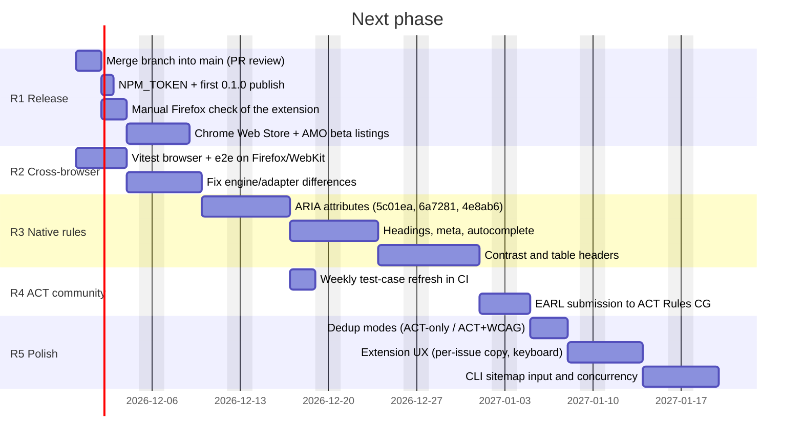

# Next phase (revised plan, 2026-11-26)

The original plan ([overview.md](overview.md)) is fully implemented. This plan covers what
comes next. It starts on the next working day, and assumes the same team: the project
owner plus AI agents.

## Starting point

- **11 packages:** core, engine-axe, engine-ibm, engine-native, sdk, matchers,
  playwright, cypress, cli and extension (plus the private workspace root).
- **210 tests** run in happy-dom, Chromium, a real `@playwright/test` run, a real
  Cypress run, the built CLI and the built extension.
- **The native engine** has 12 rules, consistent with all 204 official W3C ACT test
  cases.
- All the work is on the branch `claude/youthful-shannon-im5dum` and is **not merged
  into `main` yet**. CI is green.

## Phases

| Phase | Scope | Owner |
|---|---|---|
| R1 | Release: merge into `main`, npm 0.1.0, Firefox check, store betas | Project owner (agents prepare) |
| R2 | Cross-browser: run the suites in Firefox and WebKit, fix differences | Agents |
| R3 | Native engine, second rule set (about 12 more ACT rules) | Agents |
| R4 | ACT community: EARL submission, tracking new test cases | Agents + owner |
| R5 | Product polish: dedup precision, extension UX, CLI crawling | Agents |

## R1 — Release

The project owner does this phase; agents can prepare PRs and checklists.

- Open and review the PR from `claude/youthful-shannon-im5dum` into `main`.
- Add the `NPM_TOKEN` secret. The release workflow opens a "Version packages" PR; merging
  it publishes 0.1.0 of every public package with provenance.
- Load the `browser-extension` CI artifact in Firefox (`about:debugging`) and check the
  panel on a few real sites, with all three engines.
- Submit to the Chrome Web Store and AMO, using `packages/extension/STORE.md`.

**Done when:** the packages are on npm, and both stores have an (unlisted) beta.

## R2 — Cross-browser

- Add Firefox and WebKit instances to the Vitest `browser` project and to the Playwright
  adapter's e2e tests. Add `--browser firefox|webkit` coverage to the CLI e2e tests.
- Run the ACT harness in Firefox and WebKit. The native engine relies on
  `checkVisibility`, focus behavior and accessible-name details that may differ.
- Install the extra browsers in CI (`playwright install --with-deps firefox webkit`).

**Done when:** the suites pass in all three browsers, or the remaining differences are
documented.

## R3 — Native engine, second rule set

Candidate ACT rules, all with official test cases:

- ARIA attributes: `5c01ea` (state or property is permitted), `6a7281` (valid value),
  `4e8ab6` (required states and properties).
- Content: `ffd0e9` (heading has non-empty accessible name), `73f2c2` (autocomplete
  attribute has valid value).
- Meta: `b4f0c3` (meta viewport allows zoom), `bc659a` and `bisz58` (meta refresh).
- Visual: `afw4f7` (text has minimum contrast) and `09o5cg` (enhanced contrast). These
  need layout.
- Tables: `a25f45` (headers attribute refers to cells in the same table).

Each rule ships only when it is consistent with all its official test cases. Run
`pnpm fetch:act` after adding its ID to the fetch script.

## R4 — ACT community

- Add a scheduled CI job that refetches the test cases weekly and reports when new or
  changed test cases break consistency.
- Submit `act-report.earl.json` to the ACT Rules Community Group, following its
  implementation report process.

## R5 — Polish

- Dedup modes: the current matching (shared ACT rule or WCAG criterion on the same
  element) can merge two different problems under the same criterion. Offer a stricter
  ACT-only mode.
- Extension: copy the selector or HTML of an issue, better keyboard navigation of
  results, and remember the last report per tab.
- CLI: `--sitemap <url>`, concurrency for many URLs, and a summary table.

## Risks

- **Store reviews**: broad host permissions and bundled engines (`Function` and
  `innerHTML` warnings come from axe-core) can slow reviews. `STORE.md` has the
  justifications.
- **Browser differences**: visibility and focus heuristics in the native engine may
  behave differently outside Chromium (R2 exists for this).
- **Contrast rules** need real rendering (backgrounds, images, gradients), which makes
  them the hardest to get consistent.
