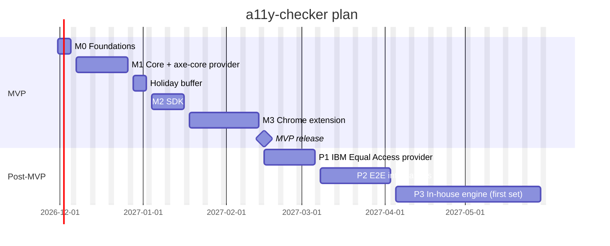

# a11y-checker — Plan overview (2026-11-26)

## Vision

An accessibility validator built around a **multi-engine core**. It is offered as:

1. An **SDK** (npm package) that runs in any DOM environment.
2. A **Chrome extension** (Manifest V3) with a DevTools panel.
3. Later: **E2E test integrations** (Playwright, Cypress, test-runner matchers, CI).

## Strategy

- **Wrap axe-core first.** Our own result model, configuration and runner come first.
  axe-core is the first *engine provider*, which gives us a working MVP quickly.
- **Design for several engines from day one.** The `EngineProvider` interface must
  allow us to add **IBM Equal Access** and, later, a **100% in-house engine**
  without breaking changes to the public API.
- **The engine does not depend on its environment.** It only needs `window`/`document`.
  It does not use Node or Chrome APIs. The same bundle runs in a content script,
  in Playwright `page.evaluate()` and in jsdom/happy-dom.
- **Results are normalized and mapped to standards.** Every issue maps to WCAG success
  criteria and, where possible, to W3C ACT rule IDs. Mapping to ACT rules is what lets
  us merge duplicate results from different engines later.

## Phases

| Phase | Scope | Detail |
|---|---|---|
| M0 | Foundations: monorepo, tooling, CI | [mvp.md](mvp.md#m0--foundations) |
| M1 | Core engine + axe-core provider | [mvp.md](mvp.md#m1--core-engine--axe-core-provider) |
| M2 | SDK: public API, reporters, npm release | [mvp.md](mvp.md#m2--sdk) |
| M3 | Chrome extension (MV3) | [mvp.md](mvp.md#m3--chrome-extension) |
| P1 | IBM Equal Access provider + cross-engine dedup | [post-mvp.md](post-mvp.md#p1--ibm-equal-access-provider) |
| P2 | E2E integrations | [post-mvp.md](post-mvp.md#p2--e2e-integrations) |
| P3 | In-house engine | [post-mvp.md](post-mvp.md#p3--in-house-engine) |

## Schedule

We assume one developer working full time. Durations are in working days.



The MVP is expected around **mid-February 2027**.

## Package layout

```
packages/
├── core          # runner, result model, config, EngineProvider interface
├── engine-axe    # axe-core provider (M1)
├── engine-ibm    # IBM Equal Access provider (P1)
├── engine-native # in-house rules (P3)
├── sdk           # public API + reporters (JSON, SARIF, HTML)
├── extension     # Chrome MV3 extension (WXT)
└── (P2) playwright, cypress, vitest/jest matchers, cli
```

## Key dependencies

| Dependency | License | Use |
|---|---|---|
| axe-core | MPL-2.0 | First engine provider |
| accessibility-checker-engine (IBM) | Apache-2.0 | Second engine provider (P1) |
| aria-query, dom-accessibility-api | Apache-2.0 / MIT | ARIA data and accessible name computation (P3) |
| W3C ACT Rules test cases | W3C | Validating and comparing engines |
| WXT | MIT | Chrome extension framework |
| Vitest, Playwright | MIT / Apache-2.0 | Unit tests and real-browser tests |

## Main risks

- **No layout in jsdom/happy-dom.** We cannot test contrast, visibility or target size
  there. Mitigation: run those tests in a real browser (Playwright or Vitest browser mode).
- **Duplicate or conflicting findings across engines.** Mitigation: map results to ACT/WCAG
  from M1, and dedup in P1.
- **iframes and shadow DOM.** Mitigation: include them in the M1 test fixtures, and use
  `all_frames` injection in the extension.
- **Chrome Web Store review delays.** Mitigation: submit an early beta during M3.
- **In-house engine scope creep.** Mitigation: P3 targets a small, ACT-validated rule set
  and does not aim for parity with axe.
