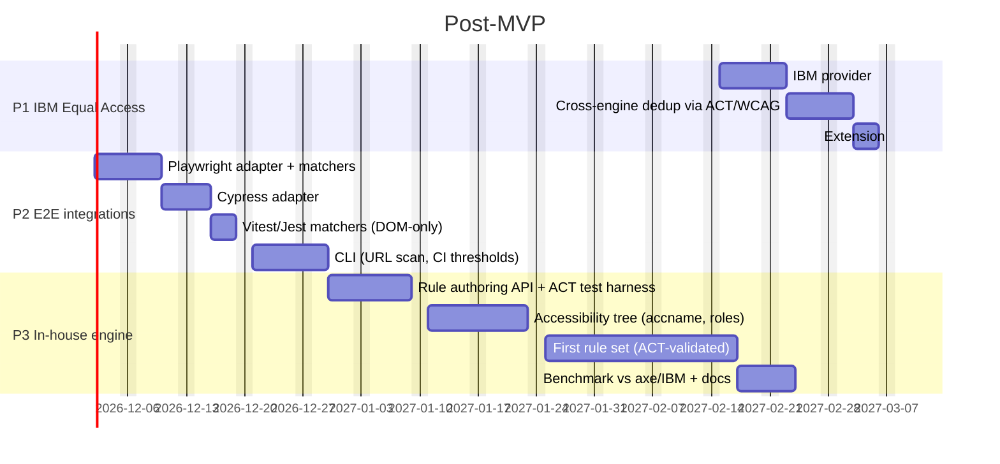

# Post-MVP plan (2026-11-26)

These phases come after the MVP. The order and durations will be reviewed at MVP release,
and a new dated roadmap will be created if the plan changes.

## P1 — IBM Equal Access provider

- `engine-ibm` wraps `accessibility-checker-engine` behind the same `EngineProvider` interface.
- Results from different engines that point to the same node and the same ACT rule or WCAG
  criterion are merged into one issue that lists every engine that reported it.
- The extension and the reporters can filter results by engine.

## P2 — E2E integrations

- `@a11y-checker/playwright`: `checkA11y(page, options)` plus a `toBeAccessible()` matcher.
  Results are attached to the test report.
- `@a11y-checker/cypress`: a `cy.checkA11y()` command.
- Vitest/Jest matchers for component tests (DOM-only rules).
- CLI: scan a list of URLs, apply failure thresholds, output SARIF for CI.
- Later: screen reader automation (e.g. Guidepup) and keyboard-flow testing.

## P3 — In-house engine

- A rule authoring API modeled on the W3C ACT Rules format (applicability and expectations).
- An accessibility tree layer built on `aria-query` and `dom-accessibility-api`, with the
  option to use the browser's own tree through CDP when it is available.
- The first rule set targets gaps and known false positives in axe/IBM. Every rule must
  pass the corresponding ACT test cases, and we publish an EARL conformance report.
- The goal is a high-quality set of complementary rules, not parity with axe.
